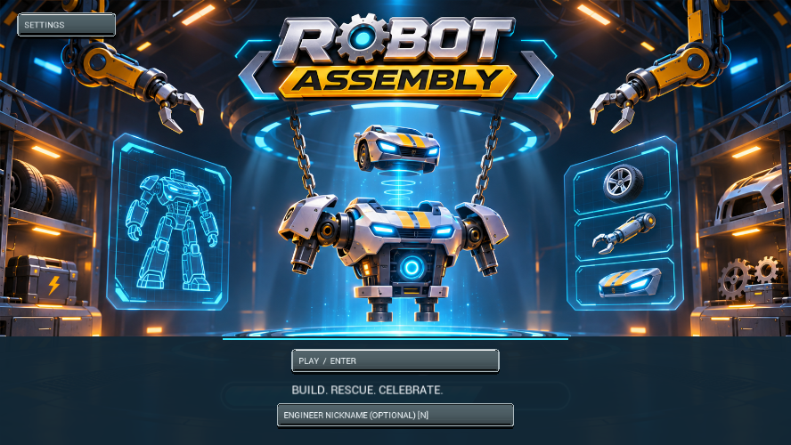

# Robot Assembly / Robot Rescue

A Windows Unreal Engine 5.8 engineering game for children aged 5–10. Build a robot friend, solve wiring puzzles, then assemble Zip the robot car.



## What is included

- **Level 1:** fit limbs, gears, motor and battery; draw red positive and black negative PCB connections; attach the head; pull the lever and celebrate with a dance.
- **Level 2:** drag tyres onto Zip, align the engine and swap cylinders into order, wire the battery, attach headlights, lower the hydraulic lift and celebrate with revs, wheelies, exhaust puffs, horn calls and a descending red beacon. Zip repairs take place in a desert scrapyard workshop.
- Illustrated main menu, level selection, loading transition, settings, reduced motion, local unlocks and customisations.
- Both levels have subtle wall doodles, portrait dialogue panels and distinct offline robot voices. Music and effects soften during dialogue.
- “Running on Waves” plays through the menus and loading screen and accompanies Zip’s 13-second dance. Level 1 uses “Fun” in the workshop and a separate song for Bolt’s 19-second dance.
- Level 1 starts unlocked. Completing it unlocks Level 2. Selecting either level always starts a fresh repair while retaining unlocks and styles.

This repository includes the C++ source, project configuration, workshop map and imported Unreal assets. It does **not** include Unreal Engine, a prebuilt executable, generated caches or personal save files. Game Foundry is not needed to build or play this checkout.

## Requirements

1. Windows 10/11, 64-bit.
2. **Unreal Engine 5.8** installed through Epic Games Launcher.
3. **Visual Studio 2022 Build Tools** (or Visual Studio 2022), with **Game development with C++**, the MSVC v143 compiler and a Windows SDK. The existing build was tested with MSVC 14.44 and Windows SDK 10.0.26100.0.
4. A DirectX 12 / Shader Model 6 GPU. Hardware Lumen ray tracing is enabled; the current build was verified on an NVIDIA RTX 3060. Other hardware has not been certified.

Use a short checkout path, such as `C:\Projects\robotassembly`, to avoid Unreal/Windows path length problems. The first build and shader compilation can take several minutes.

## Get the project

```powershell
git clone https://github.com/samyola86/robotassembly.git C:\Projects\robotassembly
cd C:\Projects\robotassembly
```

The required `.uasset` and `.umap` files are included directly in Git. No separate asset download or Git LFS step is required.

## Build and play the standalone Windows game

Open PowerShell in the repository folder:

```powershell
powershell -ExecutionPolicy Bypass -File .\scripts\Build.ps1
powershell -ExecutionPolicy Bypass -File .\scripts\Run.ps1
```

The build script compiles, cooks and packages the game into `Builds/Windows`. You can also double-click `Builds/Windows/RobotRescue.exe`. Keep the whole `Windows` folder together when sharing the packaged game.

If Unreal is installed elsewhere, pass its **Engine** folder:

```powershell
powershell -ExecutionPolicy Bypass -File .\scripts\Build.ps1 -EngineRoot "D:\Epic\UE_5.8\Engine"
```

To check paths before starting a build:

```powershell
powershell -ExecutionPolicy Bypass -File .\scripts\Build.ps1 -ValidateOnly
```

## Open and edit in Unreal Editor

```powershell
powershell -ExecutionPolicy Bypass -File .\scripts\Build.ps1 -Editor
powershell -ExecutionPolicy Bypass -File .\scripts\Run.ps1 -Editor
```

Or build the editor target, double-click `RobotRescue.uproject`, open `/Game/Workshop`, and press **Play**. Gameplay and workshop objects are created by C++ at runtime, so edit-time map contents do not represent the complete playable scene. Close the running game before packaging a replacement.

## How to play

1. Press **Play** on the main menu, then select an unlocked level.
2. Drag parts to their outlined sockets. Keyboard users can use **Tab** to select and **Enter** to fit a part.
3. On the wiring monitor, draw two red branches from **+** to the chip's **A** pads and two black branches from **−** to its **B** pads. Keep routes apart, **Test Circuit**, then **Send to Robot**.
4. In Zip's engine puzzle, match the horizontal lines, press **Align Engine**, then drag cylinders onto one another to swap them into **1, 2, 3** order. Keyboard: left/right adjust alignment, **A** confirms, and **1/2/3** pick a cylinder and its swap destination.
5. Pull the physical lever down once assembly is complete. Zip's driving controls are stacked on the left; arrows drive, **H** honks and **B** toggles lights. **P** changes paint and **F** changes headlight colour.
6. The upper-left back arrow returns to level selection. Open the upper-right gear or press **F1** for sound, reduced motion and **Main Menu**. **Escape** pauses or resumes gameplay. **F2** toggles reduced motion.

A nickname is optional. Progress and preferences stay local; there is no game account or network requirement. Returning to a level starts a new assembly instead of restoring its ending.

## Verification

The source snapshot uploaded here passed **108 packaged runtime gameplay checks**. The receipt is in [docs/gameplay-checks.json](docs/gameplay-checks.json). This is local verification on the development machine, not a GitHub Actions CI result.

After building, run the same in-game suite in an isolated save directory:

```powershell
powershell -ExecutionPolicy Bypass -File .\scripts\Test.ps1
```

The script fails if the runtime receipt is missing or reports a failure. Test saves and logs are kept under `Saved/Automation` and are ignored by Git.

## Repository layout

| Path | Purpose |
| --- | --- |
| `Source/RobotRescue/RescueGame.cpp` | Main repair, wiring, audio, input, rendering and runtime checks |
| `Source/RobotRescue/RescueCarLevel.cpp` | Zip assembly, hydraulic lift, celebration and driving |
| `Source/RobotRescue/RescueMenu.cpp` | Main menu, level selection and fresh-start flow |
| `Source/RobotRescue/RescueActivities.cpp` | Bonus workshop activities, styles and dance controls |
| `Content/Art`, `Content/Audio`, `Content/UI` | Required meshes, materials, sounds and menu images |
| `Content/Workshop.umap` | Startup map |
| `Config` | Renderer, input and packaging configuration |
| `scripts` | Portable Windows build, run and verification helpers |

## Troubleshooting

- **Missing modules / build tools:** install the C++ workload and SDK, then run the editor build command above.
- **Engine not found:** supply `-EngineRoot` to the build or editor-run command.
- **Build cannot replace an executable:** close the previous game window and retry.
- **Long path errors:** clone to a shorter path before building.
- **Slow first launch:** allow Unreal to finish shader and asset preparation.
- **Level 2 is locked:** finish Level 1 first. Replaying a level does not erase its unlock.

## Asset provenance

The game includes project-created robot/workshop assets and user-supplied music, sound effects and menu artwork imported into Unreal. This upload does not establish separate third-party licence grants for those supplied assets; no blanket open-source licence is asserted. Verify the original asset terms before redistributing or relicensing them. Unreal Engine is licensed separately by Epic Games and is not included here.
